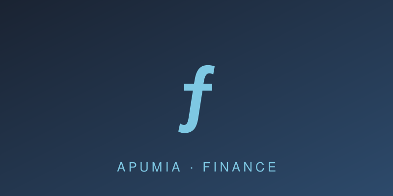

# Apumia Finance Extract

**Rust: journal audit + Altman Z + DuPont. 9 passed, 0 runtime-зависимостей.**

---

## За 30 секунд

**Что это:** Аудит журналов проводок + финансовые коэффициенты (Altman Z-score, DuPont) на Rust. Без runtime-зависимостей.

**Кому:** Бухгалтерия/финансы — внутренний аудит.

**Почему сейчас:** Excel и Python-скрипты не проходят аудит. Rust-крейт с детерминированными расчётами — проходит.

**Что доказано:** 9 passed (cargo test): 6 audit_fixes + 3 compute_ratios.

**Чего не доказано (честно):** Не для продажи как продукт — open-source крейт.

---

## Оффер

Open-source (0 ₽) или кастомная интеграция 50–80 тыс ₽.

**Следующий шаг:** Покажу cargo test — 15 минут.

---

## GitHub

- **Private code:** apumiaaifund/apumia-finance-extract
- **Public demo:** apumiaaifund/apumia-finance-extract-demo

## License

MIT
